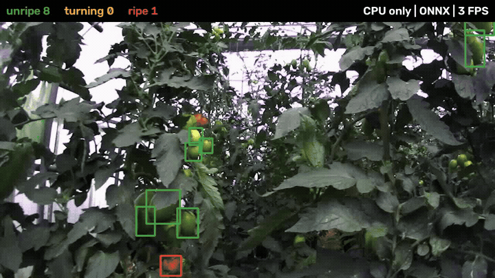

# Tomato ripeness detector: counts unripe, turning and ripe fruit on a plain CPU



*Frames from a recording pass the model never saw in training. Box colour = ripeness, top bar = counts per frame.*

## The problem

A grower wants to know, per plant row, how many tomatoes are ripe now, how many are turning and how many are still green. That decides when to harvest and how many pickers to send. Counting by hand is slow. The camera often runs on a small PC in the greenhouse with no GPU.

## What I built

- **A detector for 3 ripeness classes**, fine-tuned from RF-DETR Nano on 252 annotated greenhouse frames. RF-DETR is a recent real-time detection transformer, Apache-2.0 licensed.
- **An honest test set:** the 152 test frames come from a separate recording pass. Frames within one pass overlap by about 60%, so a random split would leak near-duplicates into the test set and inflate the score.
- **An ONNX export** that runs on the CPU with `onnxruntime`. PyTorch and a GPU are not needed at inference time.
- **Per-frame counts** for each ripeness class, drawn onto the video (`demo.py`).

## Results

Measured on the 152 held-out test frames (1,772 unripe, 38 turning, 32 ripe boxes). One trained model, exported at three input sizes:

| input | mAP50 | mAP50-95 | AP50 unripe | AP50 turning | AP50 ripe | CPU ms/frame | CPU FPS |
|---|---|---|---|---|---|---|---|
| 576 px | 0.546 | 0.217 | 0.678 | 0.307 | 0.654 | 307 | 3.3 |
| 448 px | 0.494 | 0.202 | 0.620 | 0.222 | 0.638 | 185 | 5.4 |
| 384 px | 0.450 | 0.178 | 0.564 | 0.181 | 0.605 | 139 | 7.2 |

CPU speed is for the model only: onnxruntime 1.32, all threads, mean of 200 runs, on a laptop Intel Core i9-13900H, FP32, no GPU. Laptop timings move by about ±20% between runs (thermals, power mode).

What the numbers mean:

- **Ripe fruit is found well (AP50 0.65), turning fruit is the weak spot (0.31).** There are only 223 turning boxes in training, and "turning" vs "ripe" is a judgement call even for the human annotators. More labelled turning fruit is the fix.
- **mAP50-95 is low partly because of the labels.** In the test pass the hand-drawn boxes are noticeably looser than the fruit, while the model's boxes are tight, so strict-overlap scores get penalised. On the validation frames, which come from the same pass as training, the same model scores mAP50 0.74 and mAP50-95 0.53.
- **Speed vs accuracy is a dial.** A smaller input runs about 2× faster for about 0.1 lower mAP50. Which point is right depends on your camera and hardware.
- **It does not transfer to a different greenhouse for free.** On stock footage of a different variety, close up and in bright light, it mislabels red fruit. That's expected with 252 training images from one site, and it's the reason to train on your own images.

INT8 quantization was tried: 576 px went from 3 to 4 FPS but lost 0.03 mAP50, so it isn't used.

## "Train a detector on my images": what you get

This repo is the template I use for that job:

1. **Data check:** class counts, label quality, and a split that doesn't leak (by session, camera or date, not at random).
2. **Fine-tuning** of an Apache-2.0 model (RF-DETR). You own the result, with no AGPL strings attached, unlike Ultralytics YOLO.
3. **An honest evaluation:** mAP and per-class AP on held-out data, plus pictures of where it fails.
4. **An ONNX model and a speed benchmark** on your target hardware (CPU, Jetson, or GPU).
5. **A demo video** and a short report.

## Run it

Requires [uv](https://docs.astral.sh/uv/). Training used a laptop RTX 4070 (8 GB): 60 epochs took about 45 minutes. Inference needs only a CPU.

```bash
uv sync
# 1. Data: AgRobTomato, 137 MB, https://zenodo.org/records/5596799 (unzip into data/raw/agrob/)
uv run python prepare_data.py
# 2. Train and export ONNX at 576/448/384 px (downloads RF-DETR Nano COCO weights, 349 MB, on first run)
uv run python train.py
# 3. Test metrics and CPU speed -> results.md
uv run python evaluate.py runs/nano/r576/rfdetr-nano.onnx runs/nano/r448/rfdetr-nano.onnx runs/nano/r384/rfdetr-nano.onnx
# 4. Annotated video + GIF -> assets/
uv run python demo.py runs/nano/r576/rfdetr-nano.onnx path/to/video.mp4
```

| file | what it does |
|---|---|
| `prepare_data.py` | Pascal VOC to COCO, 4 to 3 classes, split by recording pass |
| `train.py` | RF-DETR Nano fine-tune, ONNX export of the best epoch |
| `evaluate.py` | ONNX inference, mAP / per-class AP, CPU benchmark |
| `demo.py` | video to boxes, per-frame counts, mp4 + GIF |

## Data and licences

- **Data:** AgRobTomato by Magalhães, Moreira, dos Santos and Cunha (INESC TEC / University of Porto), [Zenodo 10.5281/zenodo.5596799](https://zenodo.org/records/5596799), CC BY 4.0. These are frames from a robot driving through a greenhouse in Portugal. Changes: the "reddish" and "riped" classes are merged into "ripe", "unriped" is renamed "unripe" and "breaking" is renamed "turning". The data itself is not in this repo.
- **Model:** [RF-DETR](https://github.com/roboflow/rf-detr) Nano, Apache-2.0.
- **This code:** Apache-2.0.
